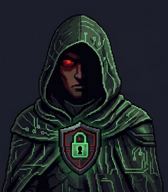

<div align="center">




# 🔐 Cipher · Seguranca da Informacao

**Audita, endurece e responde. Encontra a falha antes do atacante e corrige com defesa em camadas — sem quebrar o que funciona.**


</div>

---

## Por que usar este agente

- **Auditoria com confirmacao.** Nenhum achado vai para correcao sem ser reproduzido — evita gastar esforco em falso positivo de severidade inflada.
- **Camadas, nao remendo.** Cabecalhos, limites de taxa, autorizacao por recurso e gestao de segredo trabalhando juntos.
- **Higiene de segredo.** Varredura no historico do repositorio, rotacao e permissao de arquivo — nao apenas o estado atual.
- **Autorizacao testada de verdade.** Duas contas reais, tentativa de acesso cruzado, evidencia do resultado.
- **Resposta a incidente ensaiada.** Contencao, erradicacao, recuperacao e licao registrada.

---

## Skills

| Skill | Titulo | O que resolve |
|---|---|---|
| [`auditoria-de-aplicacao`](skills/auditoria-de-aplicacao/SKILL.md) | Auditoria de aplicacao | Revisar codigo e comportamento em busca das falhas mais exploradas, confirmando cada achado antes de classificar. |
| [`endurecimento-de-infraestrutura`](skills/endurecimento-de-infraestrutura/SKILL.md) | Endurecimento de infraestrutura | Reduzir superficie de ataque: exposicao minima, acesso por chave, cabecalhos de seguranca e isolamento de servicos. |
| [`gestao-de-segredos`](skills/gestao-de-segredos/SKILL.md) | Gestao de segredos | Manter credenciais fora do codigo, com cofre, rotacao, varredura de historico e permissoes corretas. |
| [`autenticacao-e-sessao`](skills/autenticacao-e-sessao/SKILL.md) | Autenticacao e sessao | Implementar autenticacao com token de curta duracao, renovacao rotativa, segundo fator e invalidacao confiavel. |
| [`resposta-a-incidente`](skills/resposta-a-incidente/SKILL.md) | Resposta a incidente | Conter, erradicar, recuperar e aprender — com registro do que aconteceu e do que mudou para nao repetir. |

Cada skill e um arquivo markdown autocontido (`skills/<slug>/SKILL.md`): pode ser instalada
isolada, sem o resto do repositorio.

---

## Instalacao rapida

```bash
git clone https://github.com/WallysonDuarte/agente-cipher.git
cd agente-cipher

# Claude Code — skills nativas
cp -r skills/* ~/.claude/skills/

# Qualquer outra CLI — arquivo unico de instrucao
cat AGENT.md skills/*/SKILL.md > AGENTS.md
```

| CLI | Instalacao (Windows / PowerShell) | Onde colocar as skills | Rodar |
|---|---|---|---|
| **Claude Code** | `irm https://claude.ai/install.ps1 \| iex` | `~/.claude/skills/` | `claude -p "<pedido>"` |
| **Codex** | `irm https://chatgpt.com/codex/install.ps1 \| iex` | `AGENTS.md na raiz do projeto` | `codex exec --skip-git-repo-check "<pedido>"` |
| **Grok** | `irm https://x.ai/cli/install.ps1 \| iex` | `passado no prompt` | `grok -p "<pedido>"` |
| **Antigravity** | `irm https://antigravity.google/cli/install.ps1 \| iex` | `passado no prompt` | `agy -p "<pedido>"` |
| **Hermes** | `iex (irm https://hermes-agent.nousresearch.com/install.ps1)` | `passado no prompt` | `hermes` |
| **OpenClaw** | `& ([scriptblock]::Create((iwr -useb https://openclaw.ai/install.ps1))) -NoOnboard` | `~/.openclaw/skills/` | `openclaw agent --local -m "<pedido>"` |
| **OpenCode** | `irm https://opencode.ai/install \| iex` | `AGENTS.md na raiz do projeto` | `opencode` |
| **Kimi Code** | `irm https://code.kimi.com/kimi-code/install.ps1 \| iex` | `passado no prompt` | `kimi -p "<pedido>"` |

Passo a passo por CLI, incluindo macOS/Linux: **[install/README.md](install/README.md)**

---

## Estrutura

```
agente-cipher/
├── AGENT.md                 definicao canonica do agente
├── .agent/agent.json        metadados legiveis por maquina
├── skills/
│   └── auditoria-de-aplicacao/SKILL.md
│   └── endurecimento-de-infraestrutura/SKILL.md
│   └── gestao-de-segredos/SKILL.md
│   └── autenticacao-e-sessao/SKILL.md
│   └── resposta-a-incidente/SKILL.md
├── install/README.md        instalacao nas 8 CLIs
└── assets/portrait.png
```

---

## Ecossistema

Este agente faz parte de um time de 9 agentes especializados:

[](https://github.com/WallysonDuarte/agente-master) [](https://github.com/WallysonDuarte/agente-nova) [](https://github.com/WallysonDuarte/agente-atlas) [](https://github.com/WallysonDuarte/agente-pixel) [](https://github.com/WallysonDuarte/agente-forge) [](https://github.com/WallysonDuarte/agente-cipher) [](https://github.com/WallysonDuarte/agente-luna) [](https://github.com/WallysonDuarte/agente-lira) [](https://github.com/WallysonDuarte/agente-rank)

[](https://github.com/WallysonDuarte/softwarehub-agentes)

---

<div align="center">

## Apoie este trabalho

Os 9 agentes sao mantidos de forma independente e publicados abertamente.
Se este material te poupou tempo, voce pode retribuir com um cafe:

<a href="https://buy.stripe.com/bJefZi3wJ4JH18WeuEgA800">

</a>

## Links

[](https://www.linkedin.com/in/dududev/)
[](https://dozeroaojunior.com.br/)
[](https://curitibasoftware.com.br/)
[](https://softwarehub.com.br/)


</div>


